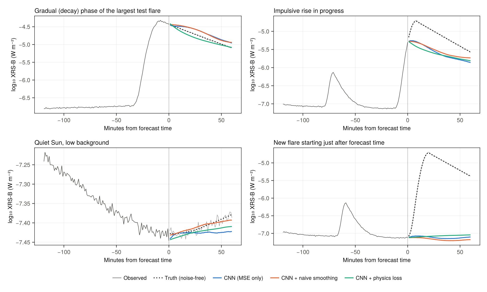

# Physics-constrained solar flare & SEP forecasting (Julia)

A 1D convolutional network forecasts the next **60 minutes** of GOES **XRS-B soft X-ray flux** and **≥10 MeV proton
flux** from the previous 3 hours, at 1-minute cadence. It is trained with a **physics-informed loss** that encodes
flare thermodynamics:

* **Cooling-time decay bound (one-sided):** log flux may not fall faster than the fastest plasma cooling allows.
  Rises stay unpenalised, because the impulsive phase can be arbitrarily fast.
* **Quiet-Sun curvature penalty:** gated on the input window, so it removes high-frequency artefacts on a quiet
  background without damping real flares.
* **Gradual-phase convexity:** exponential cooling on top of a background is convex in log space.

Built with Julia 1.10+ / Flux.jl / DataFrames.jl / CairoMakie.jl. Fully reproducible from `Project.toml` + `Manifest.toml`.

## Results (synthetic GOES-like telemetry, sealed test split, mean ± std over 3 seeds)

| Model | X-ray RMSE (dex) | X-ray, active periods | Quiet-time roughness (dex/min²) | TSS, ≥M within 60 min |
|---|---|---|---|---|
| Persistence (operational baseline) | 0.268 | 0.377 | 0 | 0.391 |
| CNN, MSE only | 0.2356 ± 0.0002 | 0.294 ± 0.002 | 6.6e-4 | 0.384 ± 0.010 |
| CNN + uniform smoothing | 0.2354 ± 0.0003 | 0.294 ± 0.003 | 4.4e-4 | 0.308 ± 0.011 |
| **CNN + physics loss** | **0.2303 ± 0.0008** | **0.282 ± 0.003** | **1.5e-4** | **0.399 ± 0.006** |

The physics loss cuts X-ray error by 14% vs persistence (25% in active periods) and by 2% vs the same CNN without it,
and removes 77% of quiet-time roughness. Uniform smoothing, by contrast, loses 20% of M-class skill. Known
limitations, stated plainly: a shared λ collapses the proton forecast to persistence, nothing forecasts brand-new
flare onsets, and zero-shot on real SWPC data the physics model is 5% *worse* than persistence (its priors are tuned to
the synthetic flare shapes). Full analysis: [`sweeps/REPORT.md`](sweeps/REPORT.md).



## Quick start

```bash
julia --project=. -e 'using Pkg; Pkg.instantiate()'
julia --project=. -e 'using Pkg; Pkg.test()'                       # unit tests
julia -t auto --project=. scripts/run_pipeline.jl --quick           # end-to-end smoke test, ~5 min
```

In VS Code or Jupyter, open `SolOnboarding.ipynb` (orientation: the data, the physics, the method, results, future
work) or start a dated notebook in `notebooks/` with `include(joinpath(@__DIR__, "..", "sol_setup.jl"))`.

Reproduce the reported numbers (λ sweep, then seeds 2–3 of the chosen models, then analysis):

```bash
printf "mse 1\nnaive_30 1\nphys_1e4 1\n" | bash sweeps/run_pool.sh 2    # one line per "tag seed"
julia -t 2 --project=. sweeps/analyze.jl                                # selection on val, test tables, figures
julia -t 2 --project=. sweeps/zero_shot_swpc.jl                         # apply to cached real SWPC data
```

## Real data

`load_swpc()` downloads SWPC's live 7-day GOES products (`xrays-7-day.json`, `integral-protons-7-day.json`), puts both
channels on one 1-minute grid (short gaps interpolated in log space, long gaps dropped), and returns the same schema as
the synthetic generator: `time, minute, xray [W m⁻²], proton [pfu]`. Every download is cached in `data/raw/`, and
`load_swpc_cache()` merges all cached files, so running `load_swpc()` weekly builds a continuous history. Windowing
never crosses a data gap. For multi-year training sets, export NCEI GOES-R XRS / SGPS netCDF to the same three
columns and use `read_telemetry_csv`.

## Layout

```
src/synthetic.jl   GOES-like generator: Hawkes-clustered power-law flares, SEPs with transport delay, noise + clean truth
src/ingest.jl      SWPC JSON download/cache/merge, 1-min regridding, CSV loader
src/windows.jl     log transform, train-only standardisation, contiguous windows, chronological split with guard gaps
src/model.jl       ResidualForecaster (CNN + persistence skip) and PhysicsLoss
src/train.jl       Adam + clip-norm, early stopping on validation MSE, seeded RNG everywhere
src/metrics.jl     RMSE by regime and lead time, roughness, cooling-bound violations, TSS
src/plots.jl       CairoMakie diagnostics
sweeps/            experiment scripts, REPORT.md (results/ is git-ignored)
notebooks/         dated working notebooks (SolMMDDYYYY.ipynb)
```

## Design notes

* **Persistence is the bar.** The network predicts a *correction* to the last observation, and its output layer
  starts at zero, so an untrained model is exactly persistence.
* **No leakage.** The split is chronological with a guard gap of W + H minutes between splits; the standardiser is fit
  on training rows only; λ is chosen on validation; the test split is scored once.
* **Scored against truth.** The generator keeps noise-free light curves, so smoothness can be told apart from bias.
* **Type-stable core.** Float32 arrays end to end, concrete struct fields, `@inbounds` loops in the generator and
  windowing, explicit broadcasting.
